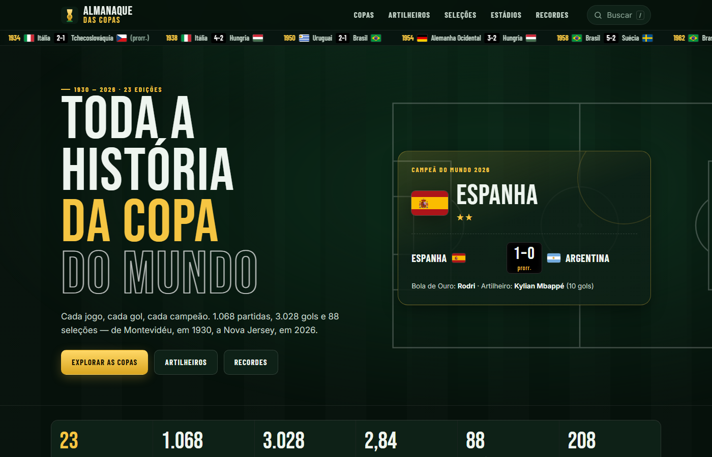
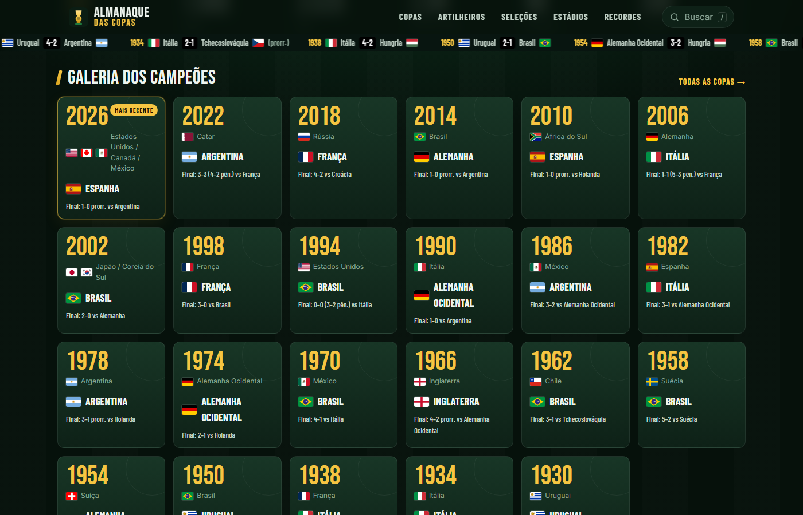
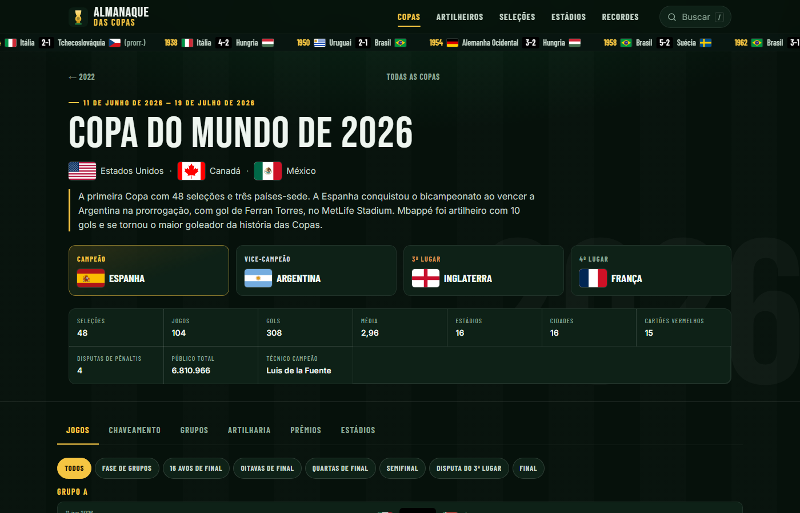
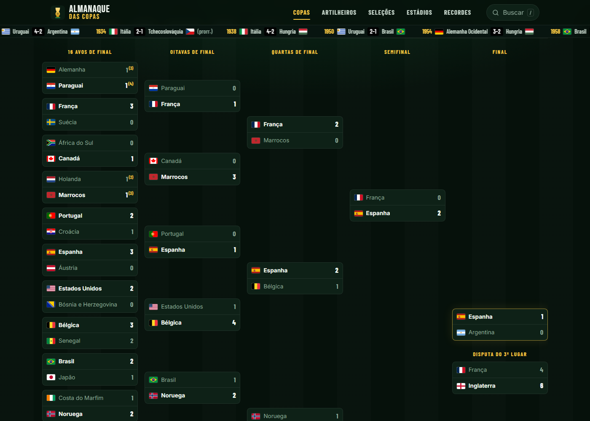
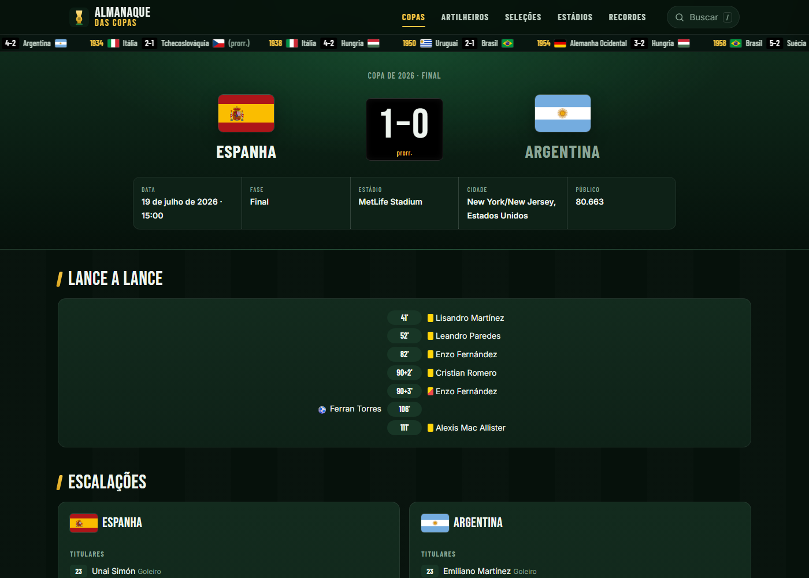
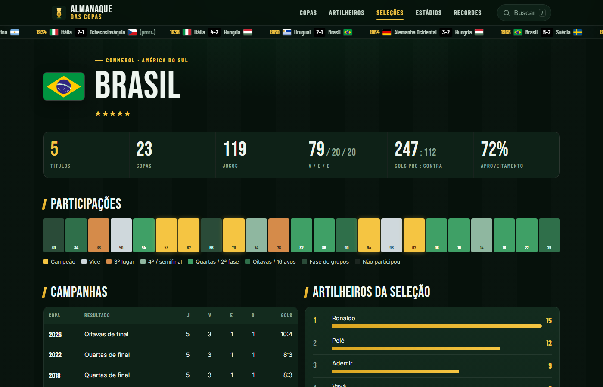
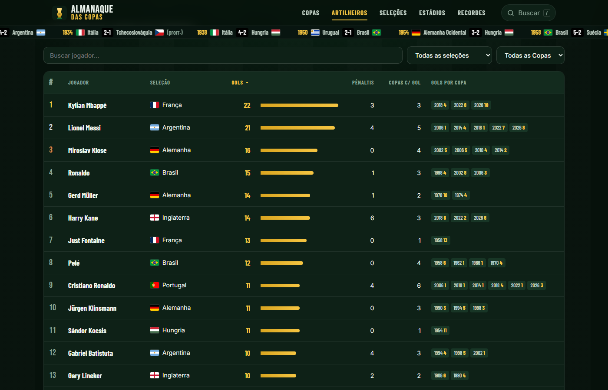
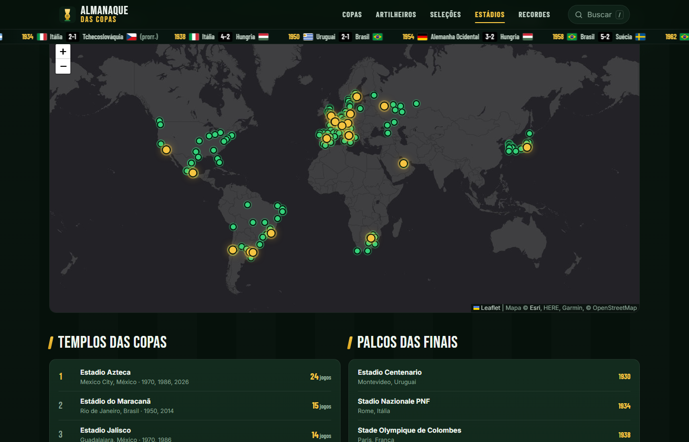
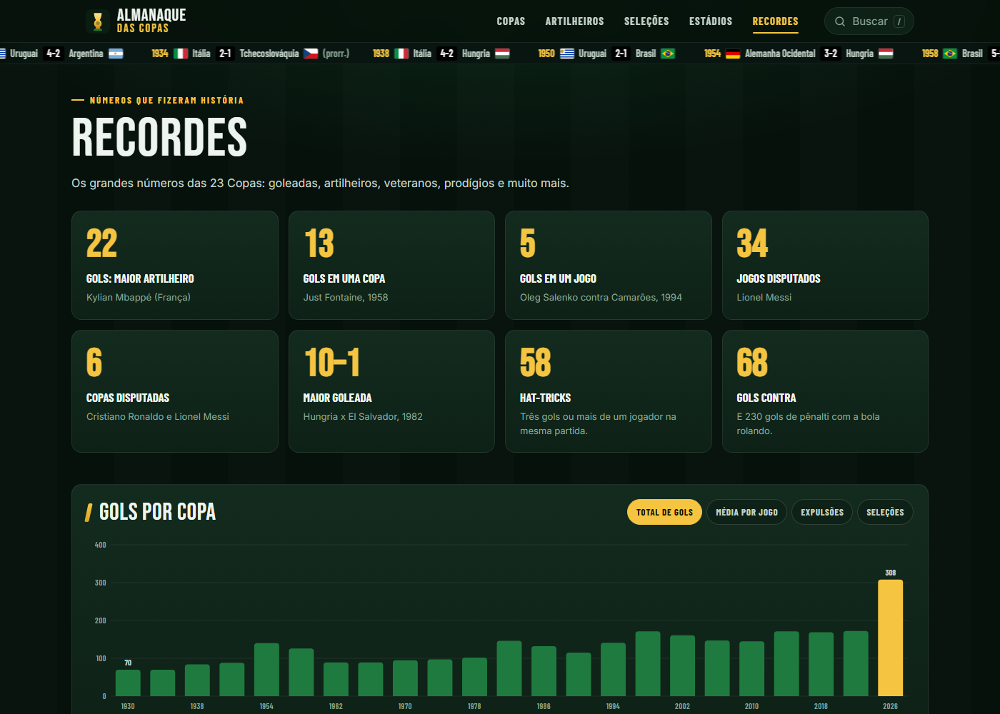
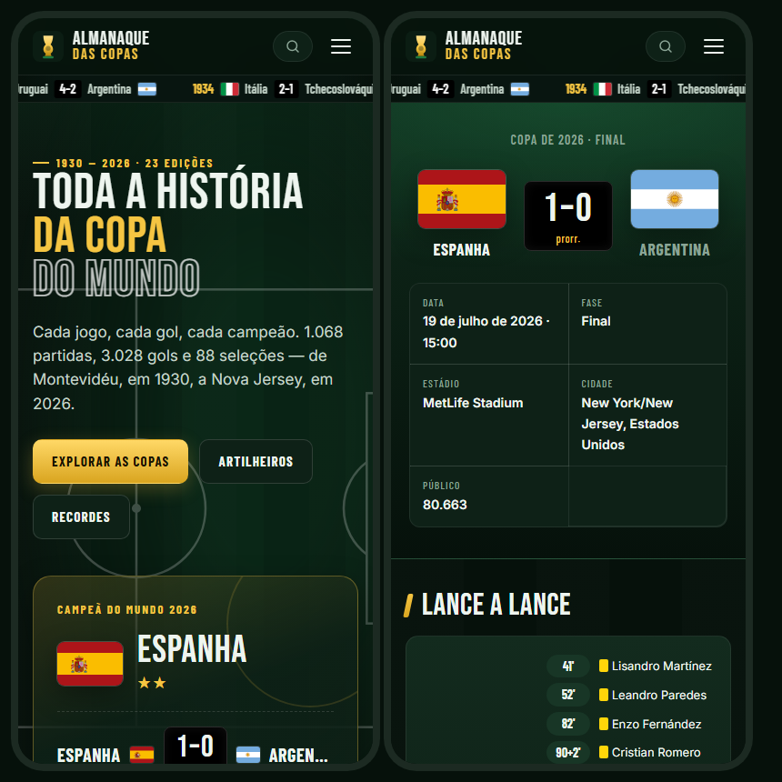

<div align="center">


# ⚽ Almanaque das Copas 🏆

**Toda a história da Copa do Mundo, de 1930 a 2026.**
Cada jogo, cada gol, cada campeão.

[](https://leonhauck.github.io/AlmanaqueDasCopas/)


</div>

---

## 📊 Em números

| 🏆 Copas | ⚽ Jogos | 🥅 Gols | 🌍 Seleções | 👟 Artilheiros | 🏟️ Estádios |
|:---:|:---:|:---:|:---:|:---:|:---:|
| **23** | **1.068** | **3.028** | **88** | **1.543** | **208** |

## 📸 Telas

### 🏠 Início


### 🖼️ Galeria dos campeões


### 🏆 Cada edição da Copa


### 🔀 Chaveamento do mata-mata


### 📺 Ficha de cada jogo — lance a lance, pênaltis e escalações


### 🇧🇷 História de cada seleção


### 👟 Ranking de artilheiros


### 🗺️ Mapa dos estádios


### 📈 Recordes


### 📱 No celular
<p align="center"></p>

## ✨ O que tem no site

| Seção | Conteúdo |
|---|---|
| 🏠 **Início** | Campeão mais recente, galeria dos campeões, ranking de títulos, maiores artilheiros, gráfico de gols e curiosidades |
| 🏆 **Copas** | Cada edição: jogos, chaveamento, grupos, artilharia, prêmios (Bola, Chuteira e Luva de Ouro) e estádios |
| 📺 **Jogos** | Placar, gols e cartões minuto a minuto, disputa de pênaltis, escalações e público |
| 👟 **Artilheiros** | Os 1.543 goleadores da história, com busca e filtros por seleção e por Copa |
| 🌍 **Seleções** | Ranking histórico das 88 seleções e uma página com a trajetória de cada uma |
| 🧑 **Jogadores** | Ficha com gols, jogos, prêmios e lista de todos os gols |
| 🏟️ **Estádios** | Mapa interativo com 208 estádios e os palcos de todas as finais |
| 📈 **Recordes** | Goleadas, hat-tricks, mais jovens e mais velhos, pênaltis, anfitriões e mais |
| 🔎 **Busca** | Aperte `/` para buscar jogador, seleção ou ano |

## 🚀 Rodar localmente

O site lê arquivos JSON, então precisa de um servidor local (abrir o `index.html` direto não funciona):

```bash
python -m http.server 8000
# abra http://localhost:8000
```

## 🗂️ Estrutura

```
index.html              página única (as rotas usam #/...)
assets/css/style.css    visual do site
assets/js/main.js       roteador, busca e faixa de placares
assets/js/ui.js         utilitários (dados, bandeiras, tabelas)
assets/js/chart.js      gráfico de barras em SVG
assets/js/views/        uma tela por arquivo
assets/flags/           bandeiras históricas (URSS, Iugoslávia…)
data/                   JSON gerados pelo script (o site lê daqui)
data-raw/               dados brutos originais
scripts/                scripts que geram data/ a partir de data-raw/
docs/screenshots/       imagens deste README
```

## 🔄 Atualizar os dados

Os arquivos em `data/` são gerados a partir de `data-raw/`:

```bash
python scripts/build_data.py      # gera data/*.json
python scripts/fetch_coords.py    # (só se mudar estádios) coordenadas via Wikipédia
```

Textos em português, nomes das seleções e o resumo de cada Copa ficam em `scripts/names_pt.py`.

## 📚 Fontes e licenças

- **1930–2022:** [The Fjelstul World Cup Database](https://github.com/jfjelstul/worldcup), de Joshua C. Fjelstul — CC-BY-SA 4.0. Os dados derivados em `data/` seguem a mesma licença.
- **2026:** [openfootball/worldcup.json](https://github.com/openfootball/worldcup.json) — domínio público. Prêmios individuais e técnico campeão de 2026 conferidos em notícias publicadas após a final.
- **Bandeiras:** [flagpedia.net](https://flagpedia.net) · **Mapa:** Esri e OpenStreetMap, via [Leaflet](https://leafletjs.com) · **Coordenadas:** Wikipédia.

Observações:
- Escalações (e, portanto, número de jogos e cartões por jogador) existem a partir de 1970.
- Seguindo a FIFA, Alemanha inclui Alemanha Ocidental e RD Congo inclui Zaire; URSS, Iugoslávia e Tchecoslováquia aparecem separadas.
- Jogos decididos nos pênaltis contam como empate nas estatísticas.

---

<div align="center">

Desenvolvido por **[Leon Hauck](https://www.linkedin.com/in/leon-hauck/)**

[](https://www.linkedin.com/in/leon-hauck/)

<sub>Projeto de fã, sem vínculo com a FIFA.</sub>

</div>
